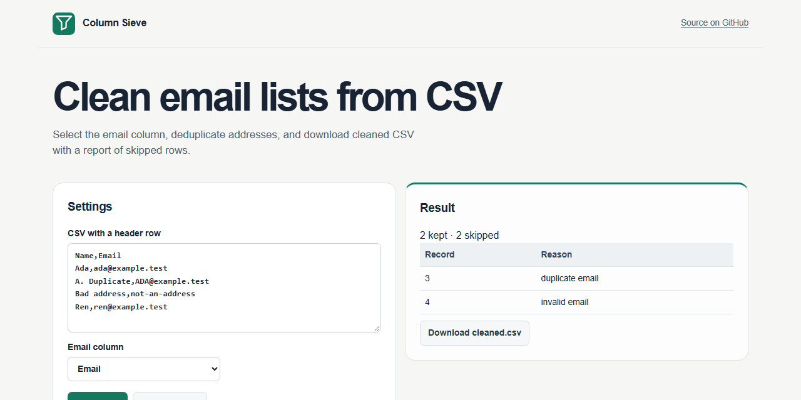

# Column Sieve

**Clean email lists from CSV.** Select the email column, deduplicate addresses, and download cleaned CSV with a report of skipped rows.

[Open the live tool](https://musabukhari237.github.io/column-sieve/) · [Report an issue](https://github.com/MusaBukhari237/column-sieve/issues)

[](https://musabukhari237.github.io/column-sieve/)

## Try an example

Choose Load example and Clean CSV. The result contains two kept rows and two skipped records. Download the cleaned CSV.

## Usage and limits

Matching is case-insensitive and preserves the first row. Email checking is syntax-only. Export protects spreadsheet formula prefixes with a leading apostrophe. Skipped records are numbered from the CSV header.

## Run locally

Clone this repository, then run:

```sh
python -m http.server 8000 --bind 127.0.0.1 --directory docs
```

Open http://127.0.0.1:8000 in a browser. The site needs no package install. Run `node --test` with Node.js 22 or newer.

## Sponsors

Supported by [LeadCeleris](https://www.leadceleris.com/) and [AIFFICIENTO](https://www.aifficiento.biz/).

## Contributing and license

Use synthetic input in bug reports and contributions. See [contribution notes](CONTRIBUTING.md) and the [MIT license](LICENSE).
